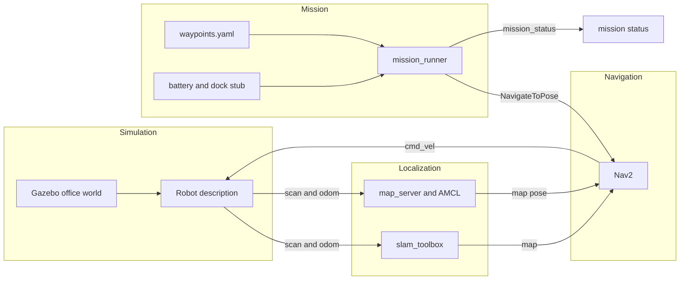

# Indoor robot SLAM and Nav2 simulation

ROS 2 Humble workspace for a small indoor robot. It has a differential-drive description, a Gazebo Classic office world, `slam_toolbox` mapping, a Nav2 launch with parameters sized for this robot, and a Python mission runner that walks a YAML waypoint list.

This is a portfolio demo by Arpan Bom. It is not a deployed robot stack, and the numbers in the parameter files were chosen from the robot geometry and the floor plan. They are not the output of a measured tuning study.

## Layout



| Package | Role |
| --- | --- |
| `indoor_robot_description` | Round diff-drive body, lidar, IMU, caster. Primitive shapes in the TurtleBot3 size class. |
| `indoor_robot_gazebo` | Office world and spawn launch. Gazebo Classic (`gazebo_ros`). |
| `indoor_robot_slam` | `slam_toolbox` online async mapping. |
| `indoor_robot_nav` | Nav2 bringup, office map, parameters for a 0.12 m radius and 0.80 m doors. |
| `indoor_robot_mission` | Waypoint parser, retries, state machine, battery and dock stub, Nav2 action client. |

The office is four rooms around a hallway: lobby, dock, office, and kitchen. The map image is a raster of that floor plan, not a map recorded from the simulator. Spawn and the AMCL initial pose are the lobby, `(-1.70, -1.55)` facing the door.

Frames: `odom` to `base_footprint` from the diff-drive plugin, `base_footprint` to `base_link` and `laser_link` from the URDF. Scan topic `/scan`, command topic `/cmd_vel`.

## Mission runner

`mission_runner` reads a waypoint file, sends `navigate_to_pose` goals, and publishes JSON on `mission_status`. A failed goal of kind `aborted` or `timeout` is retried up to `max_attempts`, with the delays in `backoff_seconds`. `rejected` fails the mission. `canceled` cancels it.

Commands on `mission_command` (`std_msgs/String`): `pause`, `resume`, `cancel`. Pause takes effect between goals, including while the stub is waiting to retry or charging.

The battery is a counter. Successful goals drain `battery_drain_per_meter` times the straight-line distance. Failed attempts drain `battery_attempt_cost`. If the next leg would drop the charge through `battery_low_threshold`, the runner sends a goal to the dock pose, then fills the counter until `dock_resume_percent` and continues the list. It does not detect a physical charger. `battery_state.percentage` is that counter scaled to 0–1. Voltage and current are NaN so they are not mistaken for measurements.

Default drain is 4 charge units per meter, so the sample route (office, kitchen, lobby) finishes without docking. Lower `battery_initial` or raise `battery_drain_per_meter` to exercise the dock path.

## Run

Requires ROS 2 Humble, Gazebo Classic, Nav2, and `slam_toolbox` on the machine where you launch the sim. Nothing here starts Gazebo in CI.

```bash
source /opt/ros/humble/setup.bash
rosdep install --from-paths src --ignore-src -r -y
colcon build --symlink-install
source install/setup.bash
```

Mapping:

```bash
ros2 launch indoor_robot_slam mapping_sim.launch.py
ros2 run teleop_twist_keyboard teleop_twist_keyboard
ros2 run nav2_map_server map_saver_cli -f "$HOME/indoor_office"
```

Navigation against the packaged map, then the sample mission:

```bash
ros2 launch indoor_robot_nav navigation_sim.launch.py use_rviz:=true
ros2 launch indoor_robot_mission mission.launch.py
```

Inspect the model without the simulator:

```bash
ros2 launch indoor_robot_description display.launch.py
```

Regenerate the world, map, and sample waypoints from `tools/indoor_layout.py`:

```bash
python3 tools/generate_assets.py
```

## Test

The mission logic is pure Python. Pytest does not import ROS and does not start Gazebo, SLAM, or Nav2.

```bash
python3 -m pip install -r requirements-dev.txt
python3 -m pytest
```

Coverage is waypoint parsing, retry decisions, the mission state machine (including dock and charge), launch-file syntax, and a check that the checked-in world and map still match the floor-plan generator.

GitHub Actions runs that pytest job on Ubuntu. A separate colcon job builds the workspace in `ros:humble-ros-base` on pushes to `main` and on manual dispatch. That job compiles only. It does not launch the simulator.

## What was not measured

| Check | Result |
| --- | --- |
| Live Gazebo spawn and lidar return | Placeholder — not measured |
| SLAM map quality against the authored floor | Placeholder — not measured |
| Nav2 goal success rate in the office | Placeholder — not measured |
| Dock approach repeatability | Placeholder — not measured |
| Battery drain of a physical platform | Placeholder — the drain rate is a stub |

## License

MIT. Copyright 2026 Arpan Bom.
